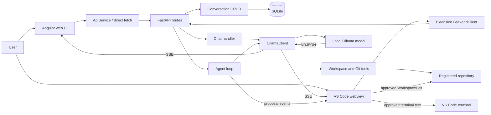
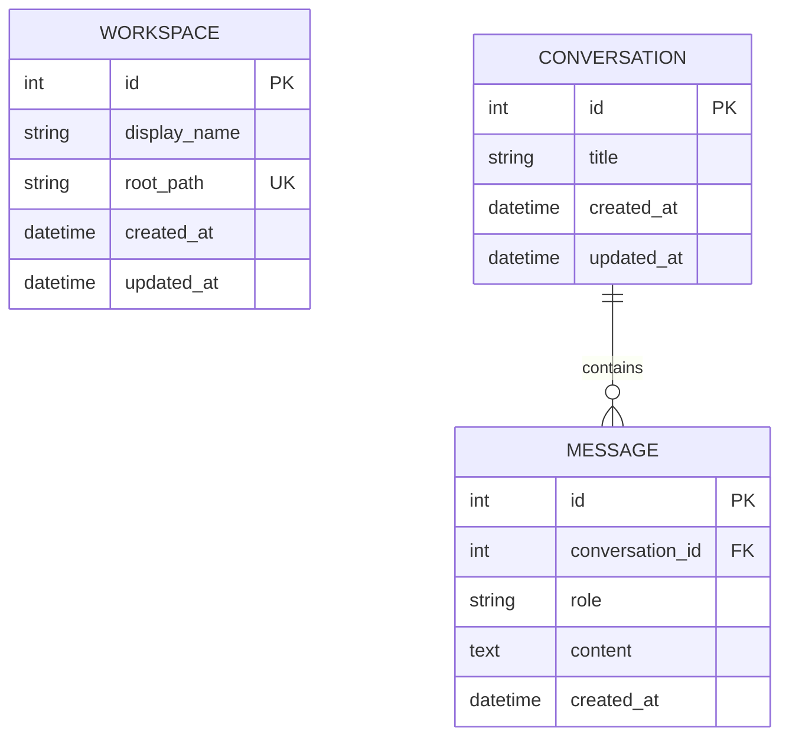

# Personal Codex — Current Implementation Report

## 1. Executive Summary

Personal Codex is a functional local-first coding assistant composed of a FastAPI backend, SQLite conversation persistence, Ollama integration, a basic Angular web client, and a substantially more capable VS Code extension. The default local model is `qwen2.5-coder:7b`.

The repository contains a real bounded coding-agent loop. It can inspect registered workspaces, list and read files, search code with ripgrep, inspect Git status and diffs, read the nearest `AGENTS.md`, propose complete-file changes, and propose terminal commands. The VS Code extension can preview proposals in a native diff editor and apply approved changes with `WorkspaceEdit`. It can also send approved commands to a VS Code terminal.

The application is not entirely a mock. Chat, streaming, persistence, repository tools, Git inspection, agent tool calling, diff previews, and file application are real. However, the legacy `/generate` endpoint remains a placeholder in `codeme_agent/prompt_engine.py:21-28`.

The strongest implementation is the VS Code extension. The Angular application is significantly less complete and contains both an unsafe Markdown rendering path and a likely server-sent-event decoding defect.

Major missing capabilities include:

- Structured patch and hunk application.
- Atomic multi-file change sets.
- File checkpoints and reliable rollback.
- File-version conflict detection.
- A controlled command-execution service.
- Command output capture and test-result feedback.
- Verification after changes.
- Context compaction and token budgeting.
- Repository maps and symbol indexing.
- Persistent tool-execution records.
- Prompt-injection defenses.
- Authentication and rate limiting.
- Multi-root VS Code support.
- Production deployment configuration.

**Estimated overall readiness: 45%.** This reflects a usable local prototype with genuine repository tools and editor integration, but not a secure or reliable autonomous coding system. Chat and inspection are comparatively mature; transactional editing, controlled execution, verification, context management, and security boundaries remain immature.

Current classification:

- **Chat application:** implemented.
- **Repository-aware coding assistant:** implemented at a basic-to-partial level.
- **Autonomous coding agent:** early prototype only.
- **Production-ready local Codex equivalent:** not ready.

## 2. Repository Information

| Item | Verified value |
|---|---|
| Project name | Personal Codex; the extension UI is branded “Personal Codeme” |
| Repository root | `F:\ai_projects\codeme` |
| Current branch | `main` |
| Upstream state | `main` is one commit ahead of `origin/main` |
| Working-tree status at audit time | Clean |
| Modified files at audit time | None |
| Untracked files at audit time | None |
| Latest commit | `42ef854` — `fix: apply agent edits to intended files` |
| Latest commit date | 2026-07-19 00:46:45 +05:30 |
| Previous major commits | `52fa900` — workspace-aware coding-agent mode; `b91dcd6` — Copilot-style local coding assistant |

No `AGENTS.md` file is currently present. The `.agents/` directory exists but contains no applicable project instructions.

`.github/copilot-instructions.md` exists, but it is an obsolete GitHub Copilot scaffold instruction. It describes creating a simple FastAPI code-generation application and does not represent the current runtime architecture. It is not consumed by the Personal Codex agent.

The agent can discover the nearest nested `AGENTS.md` in a registered user workspace through `find_agent_instructions()` in `codeme_agent/workspace.py:362-385`, but this repository itself currently supplies none.

This report file is the only artifact intentionally created after the read-only inspection. No implementation file was changed during the audit.

## 3. Verified Technology Stack

| Component | Technology | Declared version | Resolved or used constraint | Evidence | Status or concern |
|---|---|---:|---:|---|---|
| Backend language | Python | Not declared in runtime metadata | Effectively Python 3.10+ | Backend union syntax; `requirements.txt` | Python 3.8 incompatible |
| API framework | FastAPI | `0.139.2` | Exact pin | `requirements.txt:1` | Actively used |
| ASGI server | Uvicorn | `0.24.0` | Exact pin with standard extras | `requirements.txt:2`, `.vscode/tasks.json` | Actively used |
| Validation | Pydantic | `2.10.3` | Exact pin | `requirements.txt:3` | Actively used |
| Settings | pydantic-settings | `2.7.0` | Exact pin | `requirements.txt:4`, `codeme_agent/config.py` | Actively used |
| ORM | SQLAlchemy | `2.0.34` | Exact pin | `requirements.txt:5` | Synchronous use |
| Migrations | Alembic | `1.11.1` | Exact pin | `requirements.txt:6` | Installed but no migration tree |
| Database | SQLite | Python/SQLAlchemy driver | `sqlite:///./codeme.db` | `codeme_agent/config.py:16` | CWD-dependent path |
| HTTP client | HTTPX | `0.28.1` | Exact pin | `requirements.txt:7` | Synchronous streaming |
| Backend tests | pytest, pytest-asyncio | `8.4.2`, `0.24.0` | Exact pins | `requirements.txt:9-10` | Inspected, not executed |
| Web framework | Angular | `^18.2.0` | Core `18.2.14`; CLI `18.2.21` | `frontend/package.json`, lockfile lines 490 and 667 | Actively used |
| Web UI | Angular Material/CDK | `^18.2.0` | 18.2 family | `frontend/package.json:18-20` | Actively used |
| Web language | TypeScript | `~5.5.2` | `5.5.4` | `frontend/package-lock.json:13034-13041` | Strict compiler options |
| Reactive library | RxJS | `~7.8.0` | 7.8 family | `frontend/package.json:29` | Used for HTTP APIs |
| Markdown | marked | `^9.1.6` | 9.x | Both JS manifests | Angular trust bypass unsafe |
| Highlighting | PrismJS | `^1.30.0` | 1.30 family | Both JS manifests | Used by both UIs |
| Frontend tests | Jasmine/Karma | Angular-generated constraints | Karma Angular builder | `frontend/angular.json:83-102` | One stale test file |
| Extension platform | VS Code | `^1.90.0` | Manifest constraint | `vscode-extension/package.json:9-11` | Actively used |
| Extension bundler | esbuild | Manifest range | `0.19.12` | Extension lockfile lines 2296-2300 | Node 18 target |
| Extension TypeScript | TypeScript | `^5.5.4` | `5.9.3` | Extension lockfile lines 6612-6616 | Compatible lock resolution |
| Extension tests | Vitest | `^1.5.6` | `1.6.1` | Extension lockfile lines 7231-7235 | Unit tests configured |
| Local model runtime | Ollama HTTP API | Binary version not pinned | `/api/chat`, `/api/tags` | `codeme_agent/ollama.py` | External prerequisite |
| Default model | Qwen 2.5 Coder | `qwen2.5-coder:7b` | Configurable | `codeme_agent/config.py:18` | Runtime installation not verified |
| Package manager | npm | Lockfile v3 | npm-compatible | Both `package-lock.json` files | Two JS workspaces |
| Docker | None | None | None | No Docker or Compose files | Missing |
| SSR server | Express + Angular SSR | Express `^4.18.2` | Angular SSR scaffold | `frontend/server.ts` | Present, scaffold-derived |

### Python 3.8 compatibility

The backend is not Python 3.8 compatible. It uses PEP 604 union syntax such as `str | None`, introduced in Python 3.10. It also uses built-in generic types and methods requiring at least Python 3.9. The practical minimum is Python 3.10.

`PLAN.md` mentions Python 3.12 as a target, but no `pyproject.toml`, `.python-version`, package metadata, or startup assertion enforces it. Documentation should state Python 3.10+ or explicitly standardize on Python 3.12.

Angular 18 packages in the lockfile declare Node requirements in the Node 18.19+/20.11+/22 family. The extension is explicitly bundled for Node 18 in `vscode-extension/package.json:29`.

## 4. Repository Structure

```text
codeme/
├── main.py                         # FastAPI application entry point
├── requirements.txt                # Python dependency pins
├── codeme.db                       # Default SQLite database
├── README.md                       # Root setup/status documentation
├── PLAN.md                         # Partially stale implementation plan
├── .env.example                    # Non-secret configuration example
├── .vscode/
│   └── tasks.json                  # Local Uvicorn launch task
├── .github/
│   └── copilot-instructions.md     # Obsolete scaffold instructions
├── .agents/                        # Present but empty
├── codeme_agent/
│   ├── agent.py                    # Bounded repository-agent loop
│   ├── config.py                   # Pydantic settings
│   ├── crud.py                     # Persistence functions
│   ├── db.py                       # SQLAlchemy engine/session
│   ├── models.py                   # ORM entities
│   ├── ollama.py                   # Ollama client
│   ├── prompt_engine.py            # Legacy placeholder generation
│   ├── routers.py                  # FastAPI routes
│   ├── schemas.py                  # API contracts
│   ├── workspace.py                # Files, search, Git, path safety
│   └── tests/                      # Backend tests
├── frontend/
│   ├── package.json                # Angular scripts/dependencies
│   ├── angular.json                # Browser, SSR, Karma config
│   ├── server.ts                   # SSR Express server
│   └── src/app/
│       ├── chat-shell.component.*  # Basic web chat
│       ├── settings.component.*    # Workspace/Git browser
│       ├── api.service.ts          # FastAPI client
│       ├── markdown.pipe.ts        # Markdown/highlighting
│       └── models.ts               # Duplicated API types
└── vscode-extension/
    ├── package.json                # VS Code contribution manifest
    ├── src/
    │   ├── extension.ts            # Activation/commands
    │   ├── sidebarProvider.ts      # Extension orchestration
    │   ├── backendClient.ts        # FastAPI/SSE client
    │   ├── contextResolver.ts      # Editor/selection/Git context
    │   ├── editTarget.ts           # Code target inference
    │   ├── webviewHtml.ts          # CSP-protected shell
    │   └── webview/webview.ts      # Copilot-style UI
    ├── media/                      # Styles and icon
    ├── test/                       # Vitest tests
    └── src/test/                   # Electron test scaffold
```

| Directory | Responsibility | Active | Entry point | Completeness |
|---|---|---:|---|---|
| `codeme_agent/` | Backend logic | Yes | Imported by `main.py` | Functional prototype |
| `frontend/` | Angular web UI | Yes | `src/main.ts` | Basic and behind extension capabilities |
| `vscode-extension/` | Editor-integrated assistant | Yes | `src/extension.ts` | Most complete client; execution safety incomplete |
| `.vscode/` | Development launch config | Yes | `tasks.json` | Sufficient for local backend |
| `.github/` | Copilot instructions | Indirect | Copilot instruction file | Stale |
| `.agents/` | Intended agent assets | No | None | Empty |

No Docker configuration, Alembic migration tree, architecture document, deployment manifest, or Python packaging metadata was found.

## 5. Installation and Startup

### Prerequisites

- Python 3.10 or newer; Python 3.12 matches the stated target.
- Node.js compatible with Angular 18, practically Node 18.19+ or a suitable Node 20/22 release.
- npm.
- Ollama installed and running locally.
- `qwen2.5-coder:7b`, unless another installed model is configured.
- VS Code 1.90+ for the extension.

The installed Ollama inventory was not runtime-queried during this source-only audit. The backend health route is designed to return the available model list.

### Backend

```powershell
python -m venv .venv
.\.venv\Scripts\python.exe -m pip install -r requirements.txt
.\.venv\Scripts\python.exe -m uvicorn main:app --host 127.0.0.1 --port 8000
```

The VS Code task uses the same Uvicorn form in `.vscode/tasks.json`.

Database tables are initialized by `Base.metadata.create_all()` during FastAPI lifespan startup in `main.py:16-19`. There is no migration step.

### Ollama

```powershell
ollama pull qwen2.5-coder:7b
ollama serve
```

The application defaults to `http://127.0.0.1:11434` and uses Ollama’s native `/api/chat` and `/api/tags` endpoints.

### Angular frontend

```powershell
cd frontend
npm ci
npm start
```

Expected development URL: `http://localhost:4200`.

The frontend API URL is hard-coded as `http://127.0.0.1:8000/api`, so alternate addresses require source changes.

SSR is scaffolded with `npm run build` followed by `npm run serve:ssr:frontend`. Its Express server defaults to port 4000 in `frontend/server.ts:47-53`. This path was not runtime-verified.

### VS Code extension

```powershell
cd vscode-extension
npm ci
npm run build
npm run package
```

The generated VSIX can then be installed in VS Code. Documentation identifies `personal-codeme-0.3.1.vsix`.

### Environment variables

| Variable | Safe default |
|---|---|
| `APP_NAME` | `Personal Codex` |
| `APP_DESCRIPTION` | Local coding-assistant description |
| `APP_VERSION` | `0.1.0` |
| `HOST` | `127.0.0.1` |
| `PORT` | `8000` |
| `CORS_ORIGINS` | Local Angular origins |
| `DATABASE_URL` | `sqlite:///./codeme.db` |
| `OLLAMA_URL` | `http://127.0.0.1:11434` |
| `DEFAULT_MODEL` | `qwen2.5-coder:7b` |
| `WORKSPACE_ROOT` | `.` |
| `ALLOW_UNC_PATHS` | `false` |
| `MAX_FILE_SIZE_BYTES` | `1500000` |

Settings load from `.env` with unknown keys forbidden in `codeme_agent/config.py:7-8`. An `.env` containing unrelated keys can therefore prevent startup. The plain string representation of `CORS_ORIGINS` in `.env.example` also deserves validation because complex Pydantic settings may expect JSON-formatted lists.

### Ports and checks

| Service | Port | Health check |
|---|---:|---|
| FastAPI | 8000 | `GET /health` |
| FastAPI plus Ollama readiness | 8000 | `GET /api/health` |
| Angular dev server | 4200 | Browser request |
| Angular SSR | 4000 | Browser request |
| Ollama | 11434 | `GET /api/tags` |

`/health` proves only that FastAPI responds. `/api/health` checks Ollama and verifies that the configured model appears in the inventory.

No Docker startup command is supported because no Dockerfile or Compose file exists.

## 6. Runtime Architecture



Angular and the extension are independent clients of the FastAPI API. FastAPI owns validation, persistence, workspace registration, repository reads, Git reads, agent orchestration, and Ollama access. The extension—not the backend—owns actual file mutation and terminal dispatch. The Angular frontend does not use the coding-agent endpoint.

For ordinary chat, the user message is persisted, an empty assistant message is created, prior history and optional context are sent to Ollama, NDJSON chunks are converted to SSE, and each assistant chunk is appended to SQLite.

For agent mode, the backend constructs a system prompt and tool definitions, lets the model select tools, returns tool results to the model, emits file or command proposals as structured SSE events, and persists only the final assistant message. Tool traces and proposal cards are not durably stored.

Both clients can abort their fetch request. The backend does not propagate an explicit cancellation token into HTTPX or Ollama, so client cancellation does not guarantee immediate termination of inference.

The Angular stream parser appears to append raw SSE payloads without `JSON.parse`. Because the backend serializes chunks with `json.dumps()`, quotes or escaped characters may appear incorrectly. The extension uses a more deliberate structured parser.

| State | Owner |
|---|---|
| Conversations/messages | SQLite |
| Workspace registrations | SQLite |
| Repository files | Local filesystem |
| Model inventory/inference | Ollama |
| Active UI state | Angular component or webview |
| Proposed virtual documents | Extension memory/content provider |
| Terminal processes | VS Code terminal subsystem |
| Tool-call history | Current agent request only |

## 7. Backend Implementation

### 7.1 Application entry point

`main.py` creates the FastAPI application. Its lifespan calls `Base.metadata.create_all()` (`main.py:16-19`). CORS middleware uses configured local origins and broad methods/headers (`main.py:29-34`). The main router is included at `main.py:36`, and `WorkspaceError` is globally mapped to HTTP 400 at `main.py:39-41`.

Missing application-level controls include authentication, rate limiting, request correlation, global body-size enforcement, structured global exception handling, migration execution, and startup checks for database writability.

### 7.2 API inventory

| Method | Route | Purpose | Request | Response | Mode | Auth | Status | Source |
|---|---|---|---|---|---|---|---|---|
| GET | `/health` | Process liveness | None | Basic object | Regular | None | Implemented | `main.py:44-46` |
| GET | `/api/health` | Ollama/model readiness | None | Health object or 503 | Regular | None | Implemented | `main.py:49-76` |
| POST | `/generate` | Legacy generation | `GenerateRequest` | `GenerateResponse` | Regular | None | Placeholder | `main.py:79-87` |
| GET | `/api/workspaces` | List workspaces | None | `WorkspaceRead[]` | Regular | None | Implemented | `codeme_agent/routers.py` |
| POST | `/api/workspaces` | Register workspace | `WorkspaceCreate` | `WorkspaceRead` | Regular | None | Implemented | `codeme_agent/routers.py` |
| DELETE | `/api/workspaces/{id}` | Remove registration | None | 204 | Regular | None | Implemented | `codeme_agent/routers.py` |
| GET | `/api/workspaces/{id}/files` | List directory | Path/page queries | `FileListResponse` | Regular | None | Implemented | `codeme_agent/routers.py` |
| GET | `/api/workspaces/{id}/files/metadata` | Read metadata | Path query | `FileMetadata` | Regular | None | Implemented | `codeme_agent/routers.py` |
| GET | `/api/workspaces/{id}/files/content` | Read text file | Path query | `FileRead` | Regular | None | Implemented | `codeme_agent/routers.py` |
| GET | `/api/workspaces/{id}/search` | Ripgrep search | Query/page queries | `SearchResponse` | Regular | None | Implemented | `codeme_agent/routers.py` |
| GET | `/api/workspaces/{id}/git/status` | Read Git status | None | `GitStatusResponse` | Regular | None | Implemented | `codeme_agent/routers.py` |
| GET | `/api/workspaces/{id}/git/diff` | Read Git diff | Optional path | `GitDiffResponse` | Regular | None | Implemented | `codeme_agent/routers.py` |
| GET | `/api/workspaces/{id}/agents` | Find instructions | Optional path | `AgentInstructionsResponse` | Regular | None | Implemented | `codeme_agent/routers.py` |
| GET | `/api/conversations` | List/search chats | Optional query | `ConversationSummary[]` | Regular | None | Implemented | `codeme_agent/routers.py` |
| POST | `/api/conversations` | Create chat | `ConversationCreate` | `ConversationSummary` | Regular | None | Implemented | `codeme_agent/routers.py` |
| PATCH | `/api/conversations/{id}` | Rename chat | `ConversationUpdate` | `ConversationSummary` | Regular | None | Implemented | `codeme_agent/routers.py` |
| DELETE | `/api/conversations/{id}` | Delete chat | None | 204 | Regular | None | Implemented | `codeme_agent/routers.py` |
| GET | `/api/conversations/{id}/messages` | Load messages | None | `MessageRead[]` | Regular | None | Implemented | `codeme_agent/routers.py` |
| POST | `/api/conversations/{id}/chat` | Ollama chat | `ChatRequest` | SSE chunks | Streaming | None | Implemented | `codeme_agent/routers.py` |
| POST | `/api/conversations/{id}/agent` | Repository agent | `AgentRequest` | Structured SSE | Streaming | None | Implemented | `codeme_agent/routers.py` |

### 7.3 Services

| Module | Responsibility | Important behavior | Assessment |
|---|---|---|---|
| `crud.py` | Conversation/message/workspace persistence | Direct commits and chunk appends | Real but simplistic |
| `workspace.py` | Repository boundaries and read tools | Path validation, read, search, Git | Real with edge-case gaps |
| `ollama.py` | Local model HTTP integration | Stream chat, tool chat, list models | Real |
| `agent.py` | Bounded model/tool loop | Snapshot, dispatch, proposals | Real prototype |
| `prompt_engine.py` | Legacy generation | Canned special case and TODO | Placeholder |
| `config.py` | Environment-backed settings | Defaults and `.env` parsing | Real, development-oriented |

### 7.4 Ollama integration

- Base URL: `http://127.0.0.1:11434`.
- Default model: `qwen2.5-coder:7b`.
- Model inventory: `GET /api/tags`.
- Ordinary chat: `POST /api/chat` with `model`, `messages`, and `stream: true`.
- Agent tool chat: non-streaming `/api/chat` with `tools` when available.
- Streaming protocol: Ollama NDJSON decoded line by line and re-emitted as SSE.
- Ordinary timeout: 120 seconds.
- Tool-chat timeout: 180 seconds.
- Inventory timeout: 5 seconds.
- Retry: none in the backend Ollama client.
- Cancellation: no explicit model cancellation token.
- Context: persisted messages plus optional client context; agent uses the last 20 messages.
- Failure: `/api/health` returns 503 when Ollama or the configured model is unavailable.
- Cloud APIs: none found in application source.

### 7.5 Configuration

Configuration comes from defaults, environment variables, and `.env`. Actual secret values were not inspected.

The default endpoints bind intended usage to loopback addresses, but the application does not enforce loopback if the user launches Uvicorn differently. No development/production configuration split, secret store, or encrypted settings layer exists. The extension warns about non-local backend URLs but does not prohibit them.

## 8. Database and Persistence

The default engine is SQLite at `sqlite:///./codeme.db`. Because the URL is relative, the location depends on the backend process working directory.



The Workspace table has a unique root path and friendly display name but no relationship to conversations. Conversation has an ordered one-to-many Message relationship with cascade delete-orphan behavior. Message stores a role string, text content, and timestamp; no database constraint enforces allowed roles.

Missing persistence models include settings, tool executions, approvals, command runs, file proposals, checkpoints, plans, model metrics, and conversation-to-workspace association.

Alembic is installed but no `alembic.ini`, environment, or version scripts exist. Tables are created directly at startup, making future schema evolution unsafe for existing databases.

CRUD methods generally commit directly. Streaming replies are appended and committed chunk by chunk, causing many small transactions, potential SQLite contention, partial replies, and empty assistant messages when a stream fails early. Conversation `updated_at` may not change when only a related message is added, so recent-chat ordering may become inaccurate.

## 9. Frontend Implementation

### 9.1 Application structure

The browser bootstraps from `frontend/src/main.ts`, with SSR through `src/main.server.ts`. `AppComponent` is standalone. `/` routes to `ChatShellComponent`; `/settings` routes to `SettingsComponent`. State is stored directly in component fields with no shared application store. `ApiService` wraps JSON APIs, while ChatShell bypasses it and uses direct `fetch` for streaming.

### 9.2 ChatGPT-style features

| Feature | Status | Evidence/notes |
|---|---|---|
| Conversation sidebar | Implemented | `chat-shell.component.html` |
| New conversation | Implemented | Persisted through API |
| Conversation history | Implemented | `listConversations()` |
| Rename | Missing in chat UI | Backend/service support exists |
| Delete | Missing in chat UI | Backend/service support exists |
| Conversation search | Missing in UI | Backend supports query |
| Chat messages | Implemented | User/assistant rendering |
| Markdown | Implemented, unsafe | `markdown.pipe.ts:25-27` trusts generated HTML |
| Code highlighting | Implemented | PrismJS |
| Copy-code | Missing | Extension has it |
| Streaming | Partial | Likely SSE JSON decoding mismatch |
| Stop generation | Client-side | AbortController only |
| Regenerate | Missing | — |
| Edit/resend | Missing | — |
| Model selection | Missing in visible UI | Model hard-coded at line 43 |
| Dark/light theme | Missing | Documentation overstates it |
| Responsive layout | Weak/partial | Fixed layout, few adaptive behaviors |
| Settings | Partial | Mainly workspace explorer |
| Error display | Basic | Component error state |
| Empty state | Basic | Minimal guidance |
| Loading indicators | Basic | Sending/loading flags |
| Tool cards | Missing | Agent endpoint unused |
| Approval dialogs | Missing | — |
| Diff viewer | Partial | Git diff text only |
| Workspace selector | Partial | Workspace list is separate from chat |
| File explorer | Implemented | Settings component |

### 9.3 API integration

| Frontend operation | Backend route | Assessment |
|---|---|---|
| `listConversations()` | `GET /api/conversations` | Aligned |
| `createConversation()` | `POST /api/conversations` | Aligned |
| `renameConversation()` | `PATCH /api/conversations/{id}` | Aligned but unused in chat UI |
| `deleteConversation()` | `DELETE /api/conversations/{id}` | Aligned but unused in chat UI |
| `getMessages()` | `GET /api/conversations/{id}/messages` | Aligned |
| `chat()` | Chat streaming route | Service method lacks incremental handling |
| Direct ChatShell fetch | Chat streaming route | Likely fails to decode JSON SSE payloads |
| Workspace list/create/delete | Workspace routes | Aligned |
| File list/read/search | Workspace file routes | Mostly aligned |
| Git status/diff | Workspace Git routes | Aligned |
| Agent instructions | Workspace agents route | Aligned |

The base URL is hard-coded in `api.service.ts:20`, while ChatShell duplicates it at `chat-shell.component.ts:118`. Errors are usually converted to component strings. Cancellation exists only for direct streaming fetch.

### 9.4 UI quality

The browser source supports describing the UI as a basic Angular Material chat rather than a polished Codex interface. Fixed sidebar dimensions weaken small-screen usability. Conversation management is incomplete. Controls do not consistently expose descriptive accessibility labels. The settings route mainly exposes workspace and Git tools rather than model/theme preferences. The stale application title remains `frontend`.

The most serious UI concern is `bypassSecurityTrustHtml` applied to model-generated Markdown. This must be replaced with a maintained allowlist sanitizer.

## 10. Workspace and Repository Intelligence

| Capability | Status | Evidence | Limitation |
|---|---|---|---|
| Register local workspace | Implemented | Workspace API/ORM | No ownership/auth |
| Multiple workspaces | Backend implemented | Workspace table/list | Extension uses first VS Code root only |
| Workspace path validation | Implemented | `canonicalize_workspace_path()` | Extension has a separate path layer |
| Traversal prevention | Implemented | `workspace.py:101-114` | Tested |
| Symlink escape prevention | Backend implemented | Resolved path remains under root | Extension application needs equivalent hardening |
| File listing | Implemented | `list_workspace_files()` | Some generated dirs omitted from exclusions |
| File reading | Implemented | `read_workspace_file()` | Text only; 1.5 MB default |
| Binary detection | Implemented | `workspace.py:140-153` | First-4-KB heuristic |
| Secret-file exclusion | Partial | Filename/suffix deny lists | No content secret scanner |
| Ripgrep search | Implemented | `search_workspace()` | Per-file max and potentially large output |
| Repository map | Basic heuristic | Agent snapshot | No persistent graph/index |
| Symbol extraction | Missing | — | — |
| Current-file context | Extension implemented | `contextResolver.ts` | Full file may be large |
| Selected-code context | Partial | Selection is read | Metadata not always distinct |
| Git status | Implemented | Argument-array Git invocation | Read-only |
| Git diff | Implemented | Working/staged | Per-file staged diff inconsistency |
| Nested `AGENTS.md` | Partial | Nearest-file search | No hierarchy merge |
| Context-size control | Partial | File/snapshot caps | No tokenizer-aware compaction |

Backend path validation resolves requested paths and requires them to remain relative to the registered root. This provides meaningful traversal and symlink protection for backend reads.

Search limitations include missing exclusions for `.angular`, `.pytest_cache`, and `.runtime`, possible absolute paths in ripgrep JSON results, and output slicing only after subprocess collection.

## 11. Agent and Tool System

A real bounded agent loop exists in `codeme_agent/agent.py`.

| Capability | Status | Evidence | Current limitation |
|---|---|---|---|
| System prompt | Implemented | `agent.py:13-23` | Static |
| Personal instructions | Missing | No personal memory | — |
| Project instructions | Partial | `read_instructions` | Nearest `AGENTS.md` only |
| Tool schemas | Implemented | `agent.py:26-124` | Fixed, hand-maintained set |
| Tool dispatch | Implemented | Agent dispatcher | No plugin registry |
| Model tool selection | Implemented | Ollama tools | Model-dependent |
| Tool-call parser | Implemented | Native/Qwen JSON variants | Heuristic fallbacks |
| Tool-result messages | Implemented | Added to current context | Not persisted |
| Inspect/observe loop | Implemented | Bounded loop | Planning implicit |
| Explicit plan | Missing | — | No plan state |
| Iteration limit | Implemented | 12 turns | Static |
| Failure detection | Partial | Expected tool errors returned | No repeated-failure detector |
| Context compaction | Missing | Last 20 messages | No summarization/token accounting |
| Cancellation | Partial | Client disconnect | No model cancellation token |
| Verification | Missing | — | Stops after proposal |
| Final summary | Partial | Prompt instruction | Not structurally enforced |
| Multi-agent | Missing | — | Single model loop |
| File proposal | Implemented | `propose_file_change` | Complete-file content |
| Command proposal | Implemented | `propose_command` | Minimal validation |
| Grounded analysis | Partial | Project snapshot | Heuristic selection |
| Audit trail | Missing | — | Only final message persists |

Architecture-like prompts use a repository snapshot and hide tools from the model. Mutation-like prompts expose proposal tools. The mutation classifier depends on literal words such as `add` and `fix`, which is brittle.

A fallback parser converts clearly labeled full-file fenced output into a safe proposal. It has overlap and target heuristics intended to prevent inserting an entire response into the active file, but ambiguous model output can still select the wrong target.

Unlike a mature Codex-style agent, the current loop cannot maintain an explicit plan, apply atomic patches, observe command output, repair failures, verify tests, checkpoint changes, or compact long context.

## 12. File Editing and Change Management

| Capability | Status | Current behavior |
|---|---|---|
| Create file | Implemented | `WorkspaceEdit.createFile` |
| Replace file | Implemented | Entire document replaced |
| Apply patch | Missing | No structured hunks |
| Multi-file editing | Partial | Independent proposals; not atomic |
| WorkspaceEdit | Implemented | Native VS Code API |
| Unified diff | Partial | Native side-by-side preview |
| Diff preview | Implemented | `vscode.diff` |
| Accept/reject | Implemented | Per proposal |
| Checkpoint | Missing | — |
| Restore | Missing | — |
| Undo | Partial | Normal editor undo only |
| Conflict detection | Missing | No base hash/version |
| Unsaved content handling | Partial | Dirty documents considered |
| Formatting | Missing | — |
| Test-after-edit | Missing | — |

The backend does not directly write proposed files, which is a useful boundary. It emits paths and complete content; the extension applies approved changes.

Full-file replacement is not equivalent to patch application. The model can omit content, large files must be regenerated, multiple changes are not atomic, concurrent editor changes can be overwritten, and there is no base-content hash. Target-inference errors can also replace the wrong file.

The structured proposal path replaces the intended target instead of appending the full proposal to the active editor. Ambiguous ordinary-chat code blocks still depend on filename inference and user choice.

## 13. Terminal and Command Execution

Terminal execution exists only in the extension. The backend proposes a single-line command. After modal approval, the extension sends raw text to a VS Code terminal with the workspace as its current directory.

| Control | Status |
|---|---|
| Command execution service | Partial; terminal only |
| Argument-array execution | Missing for proposals |
| Shell execution | Implemented through terminal text |
| Workspace working directory | Implemented |
| Allowlist/blocklist | Missing |
| Risk classification | Missing |
| User approval | Implemented |
| Timeout | Missing |
| Cancellation | Manual terminal only |
| Output-size limit | Missing |
| Output capture | Missing |
| Process-tree termination | Missing |
| Environment filtering | Missing |
| Network restriction | Missing |
| Docker sandbox | Missing |
| Audit logging | Missing |
| Test detection | Missing |
| Result returned to agent | Missing |

This is not an execution-feedback loop. The agent cannot tell whether a command succeeded or inspect test failures.

Security risk is high if users approve commands without reading them. The backend rejects only empty, multiline, or excessively long commands. Destructive Git commands, deletion, credential access, downloads, and arbitrary interpreter invocations remain possible.

## 14. Git Integration

| Capability | Status | Notes |
|---|---|---|
| Repository detection | Implemented | Backend Git checks |
| Status | Implemented | Porcelain parsing |
| Diff | Implemented | Working/staged whole-workspace diff |
| Branch display | Implemented in extension | VS Code Git API |
| Staged changes | Implemented | Included in status/full diff |
| Unstaged changes | Implemented | Included |
| Commit | No dedicated tool | Possible only as raw command |
| Revert | No dedicated tool | Possible only as raw command |
| Checkpoint | Missing | — |
| Push | No dedicated tool | Possible only as raw command |
| Pull request | Missing | — |
| Destructive-command protection | Missing | Approval only |

Backend Git inspection uses argument arrays, a workspace `cwd`, captured output, and a five-second timeout. This is appropriately read-only. A per-file diff request omits the cached/staged form, unlike the full-workspace diff.

## 15. Approval and Security Model

File changes require explicit confirmation by default through `personalCodex.requireWriteApproval`. Commands always receive a modal confirmation. Diff preview is available before applying a file.

Approval decisions are not persisted or audited. There is no risk classification or temporary policy grant. Automatic workspace initialization also appears to register the active workspace even though `autoRegisterWorkspace` defaults to false.

| Risk | Severity | Evidence | Current mitigation | Recommended mitigation |
|---|---|---|---|---|
| Angular model-output XSS | High | `markdown.pipe.ts:25-27` | Angular wrapper only | Maintained allowlist sanitizer |
| Unauthenticated backend | High if exposed | All routes lack auth | Loopback launch defaults | Enforce loopback/local token |
| Arbitrary approved command | High | Raw terminal text | Modal approval | Structured policy runner |
| Extension symlink escape | High | Apply path not fully canonicalized | Backend validates structured proposals | Revalidate real target before apply |
| Full-file stale overwrite | High | No hash/version | Diff and approval | Optimistic concurrency |
| Prompt injection | High | Repository text enters model context | System prompt | External tool policy and untrusted-content rules |
| Secret disclosure | High | Full file/diff context possible | Filename exclusions/non-local warning | Content scanner, size caps, local enforcement |
| Auto-registration setting ignored | Medium | Sidebar initialization | Local storage only | Honor explicit consent |
| No rate/body limits | Medium | Large chat context accepted | Agent schema caps | Global and route-specific limits |
| Partial DB state | Medium | Per-chunk commits | Durable partial output | Message lifecycle transaction/status |
| Search resource use | Medium | Output collected before slicing | Five-second timeout | Process output/global match caps |
| Permissive CORS methods/headers | Medium | `main.py:29-34` | Origins restricted | Narrow methods/headers |
| No audit log | Medium | No tool/approval tables | UI transcript | Persist tool decisions/results |
| Dependency risk unknown | Unknown | No audit run | Lockfiles | CI vulnerability scanning |

The extension webview has a strong CSP using `default-src 'none'`, nonce-restricted scripts, and local resources. Its custom Markdown sanitizer strips dangerous elements and common event attributes and is materially safer than the Angular renderer, although a maintained sanitizer and strict protocol allowlist would be preferable.

No active dependency vulnerability scan was performed, so no specific CVE can be inferred from version files alone.

## 16. VS Code Extension Status

A real VS Code extension exists under `vscode-extension/`, version `0.3.1`.

The manifest contributes a Personal Codeme Activity Bar container, a webview sidebar, settings, command-palette actions, and editor context-menu commands. Commands cover new chat, selection explanation/fix/refactor, test generation, current-file questions, change review, workspace registration, backend checks, and backend startup.

| Capability | Status |
|---|---|
| Activity Bar view | Implemented |
| Copilot-style webview | Implemented |
| Backend client | Implemented |
| SSE chat | Implemented |
| Structured agent SSE | Implemented |
| History/search/rename/delete | Implemented |
| Model inventory/selection | Implemented |
| Ask and Agent modes | Implemented |
| Current-file context | Implemented |
| Selected-text context | Partial |
| Git branch/diff context | Implemented |
| Markdown/highlighting | Implemented |
| Copy/open/apply code | Implemented |
| Tool activity cards | Implemented |
| Diff preview | Implemented |
| Approval UI | Implemented |
| Terminal proposal | Implemented |
| Stop generation | Client-side |
| VSIX packaging | Implemented |
| Diagnostics integration | Missing |
| Multi-root support | Missing |
| Checkpoints/rollback | Missing |
| Test feedback loop | Missing |

Important limitations:

- Only `workspaceFolders[0]` is used.
- Automatic registration appears to bypass the setting default.
- Full active documents can enter context without a configured size cap.
- Diagnostics are not collected.
- Proposal events are not persisted with conversation history.
- Retry restores the prompt to the composer rather than automatically regenerating.
- File proposals are whole-file replacements.
- Commands have no output capture or policy controls.
- Backend locality checks warn instead of enforce.
- Preview and apply have a time-of-check/time-of-use gap.

`npm run build` bundles the extension and webview, and a VSIX packaging script exists. The Electron integration script expects `dist/test/runTest.js`, but normal build scripts do not clearly compile `src/test` to that location. Integration testing therefore appears incomplete as configured.

## 17. Tests and Verification

No tests were executed during the audit because available suites or runners can create caches, temporary databases, generated bundles, browser artifacts, or downloaded VS Code test assets.

### Backend

| Item | Assessment |
|---|---|
| Framework | pytest |
| Directory | `codeme_agent/tests/` |
| Test files | 5 |
| Discovered tests | 20 |
| Type | Mostly unit tests with limited API integration |
| Covered | Agent tools, no-write proposals, Qwen parser variants, snapshots, CRUD, health, Ollama payloads, path validation |
| Security coverage | Outside-path rejection; backend proposal does not write |
| Missing | Symlinks/junctions, secrets, binary cases, search limits, cancellation, streaming failure, concurrent edits, command policy |

`test_crud.py` creates a repository-local `test_codeme.db`, so it was not safe under the audit restrictions.

### Frontend

| Item | Assessment |
|---|---|
| Framework | Jasmine/Karma |
| Directory | `frontend/src/app/` |
| Test files | 1 |
| Test cases | 3 |
| Type | Generated component tests |
| Covered | Component construction and title |
| Security coverage | None |
| Critical issue | Render test expects removed `Hello, frontend` heading |
| Missing | Streaming, sanitizer, conversation actions, cancellation, errors, workspace APIs |

### Extension

| Item | Assessment |
|---|---|
| Framework | Vitest plus Electron scaffold |
| Unit-test directory | `vscode-extension/test/` |
| Unit-test files/cases | 1 file, 7 cases |
| Integration sources | `vscode-extension/src/test/` |
| Covered | Backend URLs, requests, manifest view, UI tokens, edit-target inference |
| Security coverage | Limited target validation |
| Missing | Real activation, SSE fragmentation, approvals, dirty files, symlinks, apply failures, command safety, multi-root |

Safest commands to run later when repository writes are permitted:

```powershell
.\.venv\Scripts\python.exe -m pytest codeme_agent/tests -q
```

```powershell
cd frontend
npm test -- --watch=false
npm run build
```

```powershell
cd vscode-extension
npm run typecheck
npm test
npm run build
```

`npm run test:integration` should be attempted only after confirming compilation of `src/test` into `dist/test`.

## 18. Documentation Accuracy

| Documented claim | Actual status | Evidence | Verdict |
|---|---|---|---|
| Local Ollama chat | Implemented | `ollama.py`, chat route | Accurate |
| Default Qwen model | Implemented/configurable | `config.py:18` | Accurate |
| Persisted conversations | Implemented | ORM/CRUD | Accurate |
| Alembic migrations | Dependency only | No migration files | Incorrect |
| Angular dark/light themes | Missing | No theme control | Incorrect |
| Copy-code in Angular | Missing | Chat template | Stale |
| Settings model selector | Missing in Angular | Hard-coded model | Incorrect |
| Workspace registration | Implemented | Workspace APIs | Accurate |
| File/search/Git tools | Implemented | `workspace.py` | Accurate |
| Nested AGENTS support | Partial | Nearest only | Overstated |
| Multi-root extension | Missing | First workspace only | Incorrect |
| Diagnostics integration | Missing | No diagnostics code | Planned only |
| Phase 3.5 has no writes/shell | Both now occur | `sidebarProvider.ts` | Stale |
| Explicit workspace registration | Initialization auto-registers | Sidebar provider | Inconsistent |
| Copilot-style extension | Substantially implemented | Webview/manifest | Accurate |
| Safe file changes | Partial | Approval but no conflict check | Overstated |
| Frontend README is current | Stock CLI text | `frontend/README.md` | Inaccurate |
| `/generate` performs generation | Placeholder | `prompt_engine.py` | Misleading |

Completed work not reflected in `PLAN.md` includes the agent loop, structured proposal events, file application, command proposals, extension conversation management, diff preview, and packaging.

Missing setup details include the supported Python version, absence of migrations, security implications of non-loopback binding, differences between the two clients, terminal limitations, and the correct extension integration-test procedure.

## 19. Hard-Coded Values, Stubs and Technical Debt

### High severity

- Unsafe Angular Markdown trust bypass.
- Raw terminal command dispatch.
- No file conflict/version checks.
- No authentication when exposed.
- Heuristic file-target inference.
- No prompt-injection boundary around repository content.

### Medium severity

- Hard-coded Angular backend URLs in `api.service.ts:20` and `chat-shell.component.ts:118`.
- Hard-coded Angular model at `chat-shell.component.ts:43`.
- Default endpoints/ports duplicated across source, manifests, tests, and docs.
- SQLite content committed chunk by chunk.
- Search can collect excessive output.
- Search results may contain absolute paths.
- Generated-directory exclusions are inconsistent.
- Backend and frontend API types are manually duplicated.
- Workspace registration behavior conflicts with its setting.
- Tool and approval events are not persisted.

### Low severity

- Generated `title = 'frontend'` remains.
- `frontend/README.md` is stock scaffolding.
- `.github/copilot-instructions.md` is obsolete.
- Documentation contains encoding artifacts.
- SSR files are largely scaffold-derived.
- Duplicate integration activation tests exist.
- Alembic is unused.
- `ApiService.chat()` is effectively dead beside direct fetch.

`codeme_agent/prompt_engine.py:22-28` is the explicit runtime placeholder. It returns meaningful code only for a special reverse-string prompt and otherwise produces a TODO response.

No backend `NotImplemented` statement was found. Test mocks and the VS Code stub are legitimate test infrastructure rather than production fake services.

## 20. Current Phase Assessment

| Phase | Intended scope | Actual status | Evidence | Remaining work |
|---|---|---|---|---|
| Phase 1 | Backend/frontend chat foundation | Mostly complete | FastAPI, Angular, SQLite, Ollama | Fix browser stream/security; remove legacy placeholder |
| Phase 2 | Persistence/backend maturity, inferred from README | Partial | ORM and CRUD | Alembic, transactions, production configuration |
| Phase 3 | Workspace browsing/read tools | Basic-to-mostly complete | Files, search, Git, instructions | Repository map, symbols, stronger bounds |
| Phase 3.5 | VS Code sidebar/context | Substantially implemented but scope exceeded | Extension 0.3.1 | Multi-root, diagnostics, consent, integration tests |
| Phase 4 | Not formally defined; inferred safe editing | Early partial | Full-file proposals and diff | Patches, atomic changes, checkpoints |
| Phase 5 | Not formally defined; inferred terminal/test loop | Early partial | Raw command proposal | Controlled runner and verification |
| Phase 6 | Not formally defined; inferred autonomous production agent | Missing | No durable plans/checkpoints/observability | Context, audit, security, deployment |

`PLAN.md` formally details only Phases 1, 3, and 3.5. Phase 2 is referenced in `README.md`; Phases 4-6 are inferred from the target capabilities rather than documented definitions.

## 21. Codex-Parity Gap Analysis

| Target capability | Level | Assessment |
|---|---|---|
| Chat experience | Partial | Strong extension, weak browser UI |
| Repository understanding | Basic | Files/search/Git/snapshot; no symbols/index |
| Planning | Missing | No explicit plan representation |
| Structured tool calling | Partial | Real fixed tool set |
| Safe file modification | Partial | Approval/preview but whole-file overwrite |
| Patch application | Missing | No hunks |
| Command execution | Basic | Raw approved terminal text |
| Build/test loop | Missing | No captured results |
| Git awareness | Partial | Read-only status/diff/branch |
| Approval workflow | Partial | File and command confirmation |
| Checkpoints/rollback | Missing | Editor undo only |
| Context management | Basic | Message/file caps |
| Project instructions | Partial | Nearest `AGENTS.md` |
| Personal memory | Missing | No user memory model |
| VS Code integration | Partial | Strong sidebar but no diagnostics/multi-root |
| Offline operation | Ready | Local backend, DB, Ollama |
| Observability | Missing | No durable tool logs/metrics |
| Security boundaries | Basic | Backend paths and approval; major command/auth gaps |

Application engineering can improve orchestration, safety, context selection, and verification, but cannot make a small local model identical in reasoning quality to a proprietary hosted model. Local model limitations should be handled through smaller tools, explicit schemas, verification, retries, and conservative approvals.

## 22. Critical Blockers

### 1. No transactional patch model

Whole-file generation is error-prone and is the main source of duplicated, omitted, or misdirected content. It requires a structured change-set schema, base hashes, deterministic diffs, and VS Code integration. This should be addressed first.

### 2. No checkpoint and restore layer

Autonomous changes cannot be trusted without reliable recovery. Checkpoints must record only agent-touched files and avoid reverting unrelated user work. This should be built together with transactional patches.

### 3. Terminal execution is uncontrolled and unobservable

The agent cannot test edits, while approved commands can perform arbitrary destructive actions. A structured runner needs process management, policy, output capture, timeout, and cancellation. It should follow safe file transactions.

### 4. No verification loop

Proposals are not followed by formatting, compilation, tests, or repair. Verification depends on a safe captured command runner and should be implemented immediately after it.

### 5. Weak context management

Large repositories and long conversations will exceed local-model context or disclose irrelevant content. Repository mapping, symbols, tokenizer-aware budgets, and summaries are required.

### 6. No durable execution records

Tool calls, approvals, and failures disappear after the request. New persistence models and migrations are needed before autonomy expands.

### 7. Inadequate security boundaries

A non-loopback backend exposes unauthenticated workspace APIs, and Angular Markdown is unsafe. Loopback enforcement/local authentication and sanitization should be treated as immediate hardening.

### 8. Missing dangerous-path tests

Editing and terminal behavior lack integration coverage. Every future execution feature needs isolated path, conflict, rollback, and approval tests.

## 23. Recommended Next Phase

### Immediate phase: Transactional Safe Change Sets

The next phase should focus only on making file changes correct, reviewable, conflict-aware, and reversible.

Exact scope:

- Define a structured change-set containing one or more file operations.
- Support explicit create and modify operations.
- Require workspace-relative canonical paths.
- Include original-content hashes or document versions.
- Generate deterministic diffs.
- Support atomic multi-file preview and application.
- Revalidate paths and versions immediately before apply.
- Preserve dirty documents or require explicit resolution.
- Record approval and application results.
- Provide checkpoint restore limited to files changed by that operation.
- Keep the existing whole-file proposal event compatible while translating it into the new internal representation.

Do not implement unattended commands, automatic commits/pushes, multi-agent orchestration, cloud providers, Docker sandboxing, long-running autonomous plans, or personal memory during this phase.

Required tests:

- Traversal, absolute path, symlink, and junction rejection.
- File creation and modification.
- Atomic multi-file success and rollback.
- Dirty editor behavior.
- Base-hash conflict.
- File changed between preview and apply.
- Unicode and line-ending preservation.
- Dotfiles and extensionless files.
- Large-file limits.
- Duplicate proposals.
- Checkpoint restore without touching unrelated files.
- Approval cancellation.

Acceptance criteria:

- No proposal can modify outside the registered workspace.
- Preview and apply use the same validated base version.
- Stale proposals are rejected.
- Multiple files apply atomically or roll back.
- Every applied change has a recoverable checkpoint.
- Exact paths and diffs are shown before approval.
- No command runs during this phase.
- Existing conversation, health, workspace-read, and agent-stream contracts continue working.
- Ambiguous code blocks cannot silently target the active file.

Reuse backend path canonicalization, `propose_file_change`, the extension virtual-document provider, `vscode.diff`, native `WorkspaceEdit`, proposal cards, and SSE transport.

Preserve `/api/conversations/*`, `/api/workspaces/*` read routes, `/chat`, `/agent`, and current `file_change` event fields during a migration period.

## 24. Files Needed for External Review

### Required files

- `main.py`
- `requirements.txt`
- `.env.example`
- `README.md`
- `PLAN.md`
- `codeme_agent/config.py`
- `codeme_agent/db.py`
- `codeme_agent/models.py`
- `codeme_agent/schemas.py`
- `codeme_agent/crud.py`
- `codeme_agent/routers.py`
- `codeme_agent/ollama.py`
- `codeme_agent/workspace.py`
- `codeme_agent/agent.py`
- `codeme_agent/prompt_engine.py`
- `frontend/package.json`
- `frontend/angular.json`
- `frontend/src/app/api.service.ts`
- `frontend/src/app/chat-shell.component.ts`
- `frontend/src/app/chat-shell.component.html`
- `frontend/src/app/markdown.pipe.ts`
- `frontend/src/app/settings.component.ts`
- `vscode-extension/package.json`
- `vscode-extension/src/extension.ts`
- `vscode-extension/src/sidebarProvider.ts`
- `vscode-extension/src/backendClient.ts`
- `vscode-extension/src/contextResolver.ts`
- `vscode-extension/src/editTarget.ts`
- `vscode-extension/src/webviewHtml.ts`
- `vscode-extension/src/webview/webview.ts`
- Backend, frontend, and extension test sources

### Useful optional files

- Both `package-lock.json` files.
- UI SCSS files.
- `.vscode/tasks.json`.
- `vscode-extension/README.md`.
- Packaging scripts.
- Credential-free Git log output.
- Redacted SSE traces.
- A schema-only database dump.

### Files that must never be shared without inspection/redaction

- `.env`.
- `codeme.db` and test databases.
- `.git/`.
- `.runtime/`.
- Logs and terminal transcripts.
- Unrelated workspace source files.
- Private keys and certificates.
- Authentication tokens.
- Local settings containing private paths or credentials.
- Ollama conversations containing proprietary code.
- Generated VSIX files if they bundle local configuration.

`.env.example` is intended to be shareable but should still be reviewed before distribution.

## 25. Evidence Index

| Evidence file | Important evidence |
|---|---|
| `main.py` | FastAPI construction, lifespan, CORS, health, generate route |
| `requirements.txt` | Python dependency pins |
| `.env.example` | Configuration names/defaults |
| `.vscode/tasks.json` | Backend launch command |
| `README.md` | Setup and claimed phase status |
| `PLAN.md` | Planned scope and inconsistencies |
| `.github/copilot-instructions.md` | Obsolete scaffold instructions |
| `codeme_agent/config.py` | Ports, URLs, model, DB, workspace limits |
| `codeme_agent/db.py` | Engine/session creation |
| `codeme_agent/models.py` | ORM models |
| `codeme_agent/schemas.py` | API contracts |
| `codeme_agent/crud.py` | Transactions and streaming persistence |
| `codeme_agent/routers.py` | API routes/SSE handlers |
| `codeme_agent/ollama.py` | Ollama payloads, streaming, timeouts |
| `codeme_agent/workspace.py` | Path safety, files, search, Git |
| `codeme_agent/agent.py` | Prompt, tools, loop, proposals |
| `codeme_agent/prompt_engine.py` | Legacy placeholder |
| `codeme_agent/tests/` | Backend behavior/security tests |
| `frontend/package.json` | Angular dependencies/scripts |
| `frontend/package-lock.json` | Resolved frontend versions |
| `frontend/angular.json` | Build/SSR/Karma configuration |
| `frontend/server.ts` | SSR server and port |
| `frontend/src/app/app.routes.ts` | Browser routes |
| `frontend/src/app/api.service.ts` | API integration/hard-coded URL |
| `frontend/src/app/chat-shell.component.ts` | Chat streaming/cancellation/model |
| `frontend/src/app/chat-shell.component.html` | Browser chat controls |
| `frontend/src/app/markdown.pipe.ts` | Markdown trust bypass |
| `frontend/src/app/settings.component.ts` | Workspace/file/Git browser |
| `frontend/src/app/app.component.spec.ts` | Stale frontend tests |
| `vscode-extension/package.json` | Extension contributions/settings/scripts |
| `vscode-extension/package-lock.json` | Resolved extension versions |
| `vscode-extension/src/extension.ts` | Activation/commands |
| `vscode-extension/src/sidebarProvider.ts` | Agent orchestration, edits, terminal |
| `vscode-extension/src/backendClient.ts` | Requests, health, retries, SSE |
| `vscode-extension/src/contextResolver.ts` | File/selection/Git context |
| `vscode-extension/src/editTarget.ts` | Target inference |
| `vscode-extension/src/webviewHtml.ts` | CSP |
| `vscode-extension/src/webview/webview.ts` | Copilot-style interface |
| `vscode-extension/media/webview.css` | Layout/theme/responsive behavior |
| `vscode-extension/test/extension.test.ts` | Extension unit tests |
| `vscode-extension/src/test/` | Incomplete Electron test scaffold |
